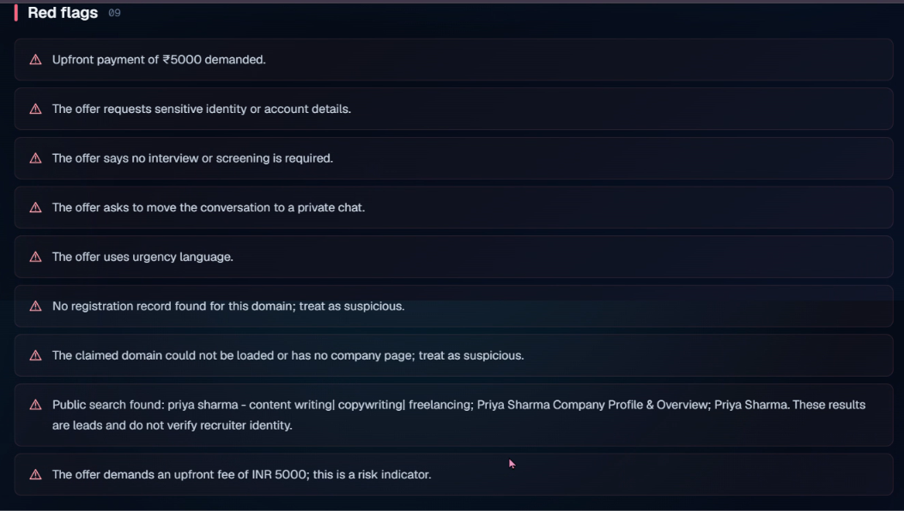
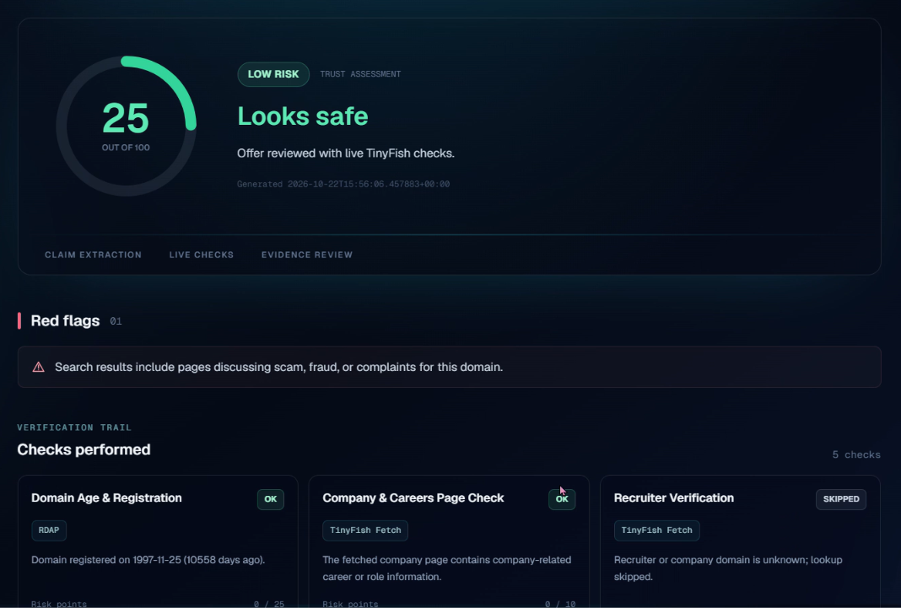
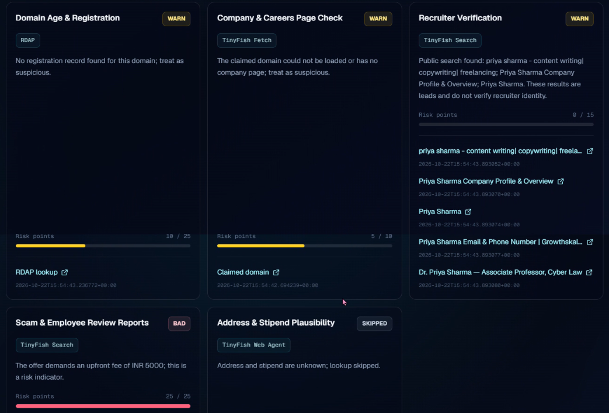
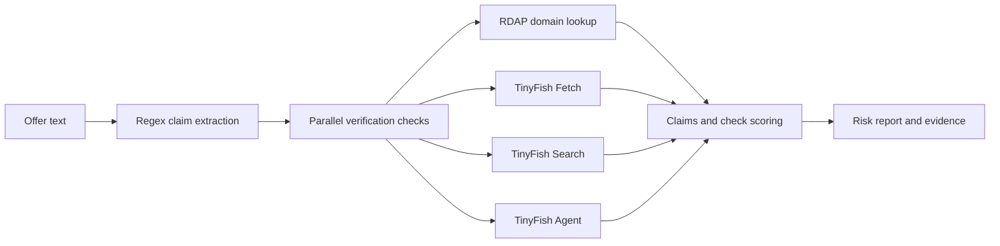

# ScamLens AI

**Check internship and job offers for scam signs.**

[Open the live demo](https://scamlens-ai-two.vercel.app) · [API docs](https://scamlens-ai-huah.onrender.com/docs) · [API health](https://scamlens-ai-huah.onrender.com/health)

## The problem

Students looking for their first internship can be targeted with fake offers that ask for security deposits, registration fees, or other upfront payments. A polished message or recruiter profile can make these requests look credible. Scammers may also ask for sensitive information such as Aadhaar details or one-time passwords. ScamLens AI helps students review suspicious offers before they pay or share personal information.

## What it does

Paste an internship or job offer message to receive a risk score from 0 to 100, a LOW, MEDIUM, or HIGH risk level, plain-language red flags, and five verification checks with source evidence links when available. Higher scores indicate greater risk. The interface also includes sample scam and genuine offers to try.

## Screenshots



*A sample offer with scam indicators and its risk report.*



*A sample TCS offer assessed with the mock verification pipeline.*



*The individual checks and their available evidence links.*

## How it works

1. **Extract claims:** the backend uses a regex-based extractor to identify claims such as company, domain, recruiter, stipend, fee, address, and scam-wording signals. Gemini credentials are read from the environment, but Gemini extraction is not currently wired into this request path.
2. **Run checks in parallel:** the backend gathers results from the five checks below. In live mode, RDAP and TinyFish services are called as indicated; mock mode uses simulated results.
3. **Score and explain:** check risk points are combined with claim-based points, capped at 100. The backend returns the level and red flags.
4. **Show the report:** the frontend displays the score, level, summary, flags, check statuses, and evidence links.

| Check | Data source |
| --- | --- |
| Domain Age & Registration | RDAP over HTTPX (`rdap.org`); not a TinyFish product |
| Company & Careers Page Check | TinyFish Fetch |
| Recruiter Verification | TinyFish Search; results are leads, not identity verification |
| Scam & Employee Review Reports | TinyFish Search |
| Address & Stipend Plausibility | TinyFish Agent |



## Tech stack

- **Backend:** Python 3.12, FastAPI, Pydantic, HTTPX, pytest
- **Frontend:** Next.js App Router, TypeScript, Tailwind CSS
- **Verification:** TinyFish Search, Fetch, and Agent; RDAP for domain registration
- **Hosting:** Render for the API and Vercel for the frontend

## Demo mode and live mode

`USE_MOCKS=true` is the default and is used for the hosted demo. It returns simulated lookups, so results are fast and free; simulated results must not be treated as live verification. The UI reads the API health endpoint and displays whether it is in Demo mode or Live mode.

Set `USE_MOCKS=false` and provide `TINYFISH_API_KEY` to use TinyFish Search, Fetch, and Agent in the checks that use those products. The domain registration check uses RDAP directly. If live mode is requested without a TinyFish key, the backend falls back to mocks. `DISABLE_AGENT_CHECKS=true` skips the Agent check to avoid Agent usage.

## Run locally

Prerequisites: Python 3.12 and Node.js with npm.

### Backend

From the repository root:

```powershell
python -m venv .venv
.\.venv\Scripts\Activate.ps1
python -m pip install -r requirements.txt
Copy-Item backend/.env.example .env
uvicorn backend.app.main:app --reload
```

The repo-root `.env` is optional. The example sets mock mode; replace placeholders only in your local environment if you choose to use live integrations. For macOS/Linux, activate the virtual environment with `source .venv/bin/activate` and copy the template with `cp backend/.env.example .env`.

### Frontend

In another terminal:

```powershell
cd frontend
npm install
Copy-Item .env.local.example .env.local
npm run dev
```

Open [http://localhost:3000](http://localhost:3000). On macOS/Linux, use `cp .env.local.example .env.local` for the copy step.

### Tests

From the repository root, install the development test dependency and run the backend suite:

```powershell
python -m pip install -r requirements-dev.txt
python -m pytest backend/tests -q
```

The automated TinyFish and RDAP tests use mocks; they do not make live requests.

## Environment variables

Values below are examples/placeholders only. Do not commit real credentials.

| Variable | Placeholder/example | Purpose |
| --- | --- | --- |
| `USE_MOCKS` | `true` | Use simulated lookups by default; `false`, `0`, or `no` requests live TinyFish mode. |
| `TINYFISH_API_KEY` | `your-tinyfish-api-key` | TinyFish authentication for live Search, Fetch, and Agent calls. |
| `DISABLE_AGENT_CHECKS` | `false` | Set `true` to skip the address/stipend Agent check. |
| `GEMINI_API_KEY` | `your-gemini-api-key` | Read by the backend, but Gemini is not currently used for claim extraction. |
| `GEMINI_MODEL` | `gemini-2.5-flash` | Read by the backend as the configured Gemini model name. |
| `ALLOWED_ORIGINS` | `http://localhost:3000,http://127.0.0.1:3000` | Comma-separated allowed browser origins. |
| `ALLOWED_ORIGIN_REGEX` | `^https://[a-z0-9-]+\.vercel\.app$` | Optional CORS regex for preview deployment origins. |
| `PORT` | `8000` | Port passed to Uvicorn locally; Render supplies its own value. |
| `NEXT_PUBLIC_API_URL` | `http://127.0.0.1:8000` | Frontend base URL for the backend API. |

## API

`POST /api/verify` accepts an offer message:

```json
{
  "text": "Urgent internship offer. Pay a ₹5000 security deposit before onboarding."
}
```

The text must be 10–5000 characters. The response contains `claims`, a list of `checks`, `risk_score`, `level`, `red_flags`, `summary`, and `generated_at`. Each check includes `name`, `tool_used`, `status` (`ok`, `warn`, `bad`, or `error`), `summary`, `risk_points`, `max_points`, and `evidence` entries with `label`, `url`, and `retrieved_at`. Requests are limited to 20 per minute per client IP.

## Deployment

### Render backend

Set the Render service root directory to the repository root.

**Build command:**

```text
pip install -r requirements.txt
```

**Start command:**

```text
uvicorn backend.app.main:app --host 0.0.0.0 --port $PORT
```

Set `USE_MOCKS=true` for the simulated hosted demo, or set `USE_MOCKS=false` and configure `TINYFISH_API_KEY` for live TinyFish checks. Configure `ALLOWED_ORIGINS` with the deployed Vercel origin; optionally set `ALLOWED_ORIGIN_REGEX` for preview deployments. `PORT` is supplied by Render.

Render's free tier may sleep while idle, so the first request after inactivity can be slow.

### Vercel frontend

Set the Vercel project root directory to `frontend` and configure:

```text
NEXT_PUBLIC_API_URL=https://scamlens-ai-huah.onrender.com
```

## Limitations and disclaimer

ScamLens AI provides a risk indicator, not a guarantee. Some sources may block automated access, lack public records, or time out; those checks are shown as warnings or errors and can affect the available evidence. Mock-mode findings are simulated and are not proof about an offer. Always verify offers through the company's official website.

## Future work

- Add screenshot and PDF offer input.
- Let users report suspicious domains and build a community scam-domain list.
- Add Hindi and other regional languages.
- Explore a browser extension for checking listings while browsing.

## Team and hackathon

- **Hackathon:** Kritical Hacks 
- **Team members:** Ira Das, Suhani Jain
- **Team Name:** Moonbyte 